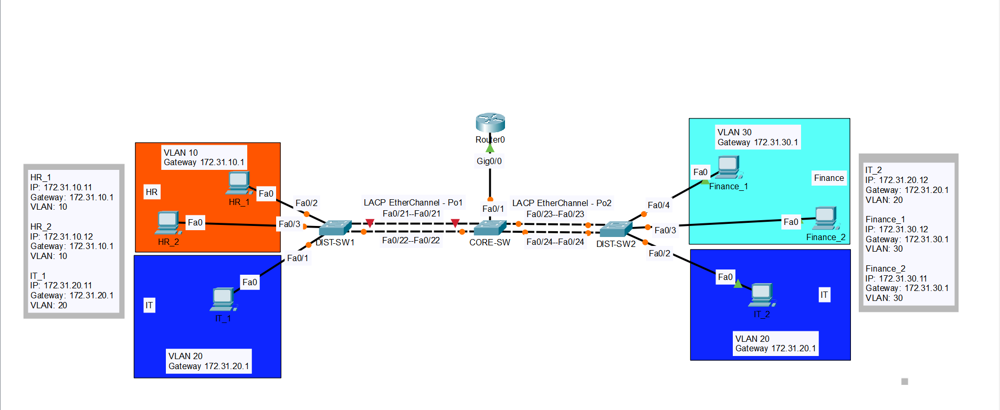
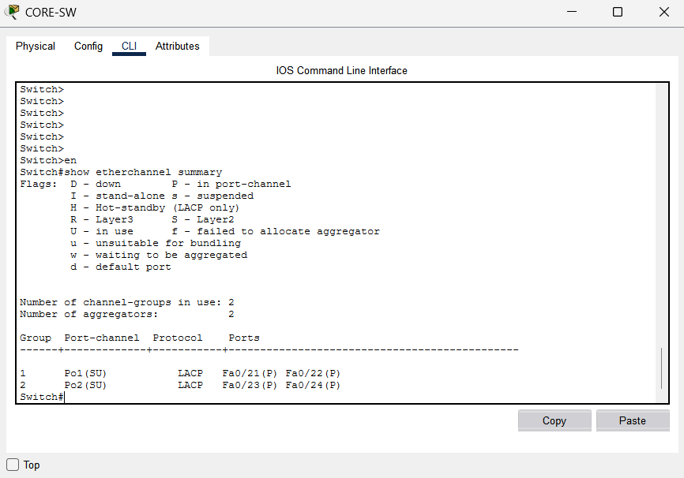

# Enterprise LAN Design with Inter-VLAN Routing and EtherChannel
## Network Topology

## Project Overview
This project demonstrates an enterprise LAN designed using Cisco Packet Tracer. It includes VLAN segmentation, inter-VLAN routing, DHCP, VTP, LACP EtherChannel, and basic network security.

## Network Devices
- 1 Cisco 2911 Router
- 3 Switches
- 6 PCs
- 3 Departmental VLANs

## VLAN and IP Addressing

| Department | VLAN ID | Network | Default Gateway |
|---|---:|---|---|
| HR | 10 | 172.31.10.0/24 | 172.31.10.1 |
| IT | 20 | 172.31.20.0/24 | 172.31.20.1 |
| Finance | 30 | 172.31.30.0/24 | 172.31.30.1 |

## Implemented Features
- VLAN configuration
- Router-on-a-Stick inter-VLAN routing
- VTP for VLAN management
- DHCP for automatic IP assignment
- LACP EtherChannel for link aggregation and redundancy
- Switch port security using sticky MAC addresses
- Basic router password protection

## Testing and Verification
### EtherChannel Verification

The following output confirms that both LACP EtherChannels are active and all four member interfaces are bundled successfully.

- DHCP address assignment verified
- Inter-VLAN connectivity tested
- Communication between PCs tested successfully
- EtherChannel status verified
- EtherChannel member-link failure and recovery tested
- Port security configuration verified

## Tools Used
- Cisco Packet Tracer
- Cisco IOS CLI
- IPv4 subnetting and networking concepts

## Learning Outcomes
This project provided practical experience in enterprise LAN design, VLANs, inter-VLAN routing, DHCP, EtherChannel, basic network security, and troubleshooting.

## Project File
The Cisco Packet Tracer project file (`.pkt`) is available in this repository.

## Author
**Sheyn Jawwad Ibn Saif**

Computer Science and Engineering Student

Interests: Networking, CCNA, and Network Security
